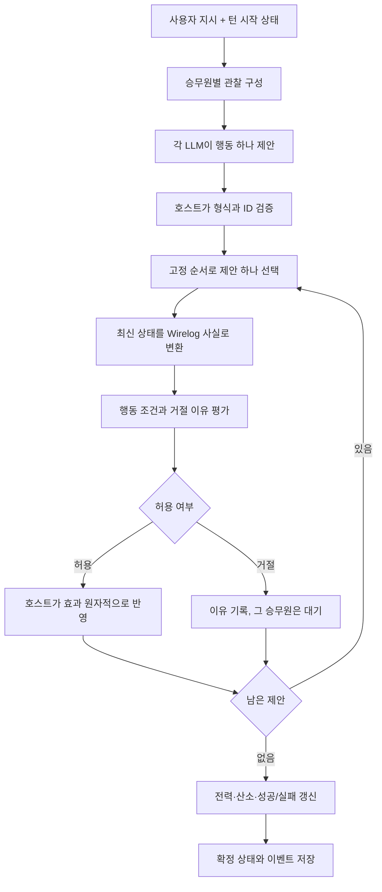

# Station Loop MVP 설계

상태: MVP 구현의 기준 설계. 실제 구현·검증 현황은 `verification.md`와 README를 따른다.
비교 실험과 후속 확장은 아직 구현하지 않았다.

## 1. 제품과 학습 목표

LLM 승무원 3명이 고장 난 우주정거장에서 제한된 자원을 사용해 협력한다.
사용자는 한 턴씩 시간을 진행하며 지시를 내리고, 제안된 행동이 실제로 허용되는지 확인한다.

첫 플레이의 질문은 “산소가 떨어지기 전에 수리 부품을 전달해 산소 생산기를 복구할 수 있는가?”다.
재미의 중심은 서로 다른 성향의 캐릭터가 상황에 반응하고 협력하는 과정이다.
기술 학습의 중심은 관찰 → 행동 제안 → 규칙 판정 → 상태 전이 → 재관찰이다.

가칭은 Station Loop. 1인 로컬 플레이, 턴 기반, 1회 최대 12턴이다.
초기 목표는 대규모 자율 사회가 아니라 끝까지 플레이하고 재현할 수 있는 한 시나리오다.

## 2. 사용자가 보는 흐름

1. 새 시나리오를 열면 지도, 산소·전력, 승무원 3명이 보인다.
2. 선택적으로 특정 승무원 또는 전체에게 지시를 보낸다.
3. “다음 턴”을 누르면 승무원들이 한 행동씩 제안한다.
4. 제안, 실행/거절, 짧은 대사를 순서대로 보여준다.
5. 행동을 선택하면 사용된 조건과 거절 이유를 펼쳐 본다.
6. 성공·실패 후 타임라인과 실행 기록을 내려받는다.

지시는 요청이다. “산소를 100으로 만들어” 같은 문장은 세계 상태를 직접 수정하지 않는다.
MVP에서 사용자는 물리적 행동을 하는 네 번째 캐릭터가 아니다.

## 3. MVP 범위

| 포함 | 후속 확장 |
|---|---|
| 제어실·온실·창고 3개 구역 | 절차적 지도, 그래픽 이동 |
| 엔지니어·의무관·탐사 담당자 | 캐릭터 생성, 장기 관계·감정 수치 |
| 전역 산소·전력과 단일 수리 부품 | 개별 체력, 제작, 전력망, 거래 |
| 이동·줍기·전달·수리·말하기·대기 | 잠금 해제, 치료, 전투 |
| 고정 사건과 구조화된 지시/자연어 메시지 | LLM의 사건·규칙 생성 |
| 공개 센서 상태와 공개 행동 기록 | 비밀, 잘못된 증언, 부분 관측 |
| 한 LLM 모델을 쓰는 3개의 분리된 캐릭터 문맥 | 서로 다른 모델, 장기 메모리 검색 |
| 단일 프로세스 실행·JSON 실행 기록 | 다중 사용자, 분산 작업 큐 |

초기 의무관은 의료 시스템을 갖지 않는다. 생존 우선의 판단 성향을 갖고 운반·대화 등
공통 행동을 한다. 의료 행위 구현을 암시하는 UI는 만들지 않는다.

## 4. 시나리오와 수치

정식 데이터는 `scenarios/life_support.json`이다. 문서와 차이가 나면 데이터를 수정하거나
문서를 함께 갱신한다. 수치는 게임용 추상 단위이며 물리 시뮬레이션이 아니다.

- 전원 제어실에서 시작. 모두 살아 있고, 개인 체력·사망 순서는 구현하지 않는다.
- 제어실↔온실, 제어실↔창고가 개방되어 있다. 온실↔창고 문은 닫혀 있다.
- 이동 1회는 열린 문 하나만 통과한다. 간접 도달 가능과 한 턴 이동 가능은 다르다.
- 산소 초기 24, 최대 24. 매 턴 승무원 3명 때문에 3 소모.
- 전력 초기 12. 부품 하나는 창고 바닥에 있고 공구는 엔지니어가 소지한다.
- 온실의 산소 생산기는 고장 상태. 엔지니어만 수리 가능.
- 수리에는 같은 구역, 공구, 본인 소지 부품 1개, 전력 2 이상이 필요하다.
- 수리에 성공하면 부품과 전력 2를 소비하고 생산기가 즉시 온라인이 된다.
- 온라인 생산기는 턴 종료 때 전력 1을 사용해 산소 4를 생산한다.
- 전력 1 미만이면 그 턴 생산하지 않고 연속 가동 카운터를 0으로 만든다.
- 최종 산소가 0 이하면 실패. 산소가 양수이며 3턴 연속 생산하면 성공.
- 12턴 종료 시까지 성공하지 못하면 시간 초과 실패. 같은 턴에는 사망 판정이 우선한다.

환경 갱신은 `산소 = min(24, 산소 - 3 + 생산량)`로 한 번에 계산한 뒤 실패를 판정한다.
소모 중간값이 0 이하라는 이유로 먼저 종료하지 않는다.

## 5. 세계 상태와 관찰

Python의 `WorldState`가 유일한 권위 상태다.

| 데이터 | 예시/역할 |
|---|---|
| `tick`, `revision` | 시간과 상태 버전 |
| `agents` | 고정 ID, 역할, 현재 구역, 인벤토리 |
| `rooms`, `doors` | 인접 관계와 개폐 상태 |
| `items` | 유일한 ID, 종류, 소유 승무원 또는 바닥 구역 |
| `devices` | 위치, 고장/온라인 상태 |
| `oxygen`, `power` | 전역 정수 자원 |
| `production_streak` | 연속 생산 횟수 |
| `events` | 확정된 행동과 환경 갱신 |

아이템은 “승무원 소유” 또는 “구역 바닥” 중 정확히 한 곳에만 존재한다.
기본 상태에서 Wirelog 사실을 만들고 결과는 파생 뷰로만 사용한다.

MVP에서는 센서 상태를 모든 승무원에게 제공한다. LLM 입력은 공개 상태, 캐릭터 성향,
최근 공개 이벤트, 사용자 지시로 제한한다. 다른 캐릭터의 내부 모델 응답이나 비공개
추론은 넣지 않는다. 전체 공개 맵에 벡터 DB를 붙이지 않는다.

## 6. 에이전트와 행동 계약

캐릭터는 같은 모델을 사용하되 역할·성향과 대화 문맥을 분리한다.

| ID | 성향 | 추가 능력 |
|---|---|---|
| engineer | 기능 복구를 우선하고 위험을 감수 | 생산기 수리 |
| medic | 산소와 생존 여유를 보존하려 함 | MVP에서는 공통 행동만 |
| scout | 자원 위치 확인과 운반을 우선 | MVP에서는 공통 행동만 |

역할별 선호는 프롬프트에 있고 권한은 규칙에 있다. 성향 문구로 수리 권한을 얻을 수 없다.
매 턴 각 캐릭터는 행동 하나와 짧은 공개 설명을 반환한다. 내부 chain-of-thought는 요구·저장하지 않는다.

```json
{
  "action": {"kind": "repair", "device_id": "oxygen_generator"},
  "utterance": "부품을 받았으니 생산기를 수리하겠습니다."
}
```

`agent_id`, `proposal_id`, `tick`, `expected_revision`은 호스트가 붙인다.
LLM이 ID를 지정해 다른 승무원으로 가장할 수 없다.

| 행동 | 인수 | 실행 조건과 효과 |
|---|---|---|
| move | `destination` | 열린 직접 연결이 있어야 함. 위치 변경 |
| pickup | `item_id` | 본인 구역 바닥에 있는 아이템. 인벤토리로 이동 |
| give | `item_id`, `recipient` | 본인 소유, 다른 수신자와 같은 구역. 소유권 이전 |
| repair | `device_id` | 수리 능력·위치·공구·부품·전력·고장 상태 검사. 부품/전력 소비 |
| say | `text` | 길이가 제한된 전체 무전. 물리 상태 변경 없음 |
| wait | 없음 | 상태 변경 없음 |

물리 행동의 `utterance`도 무전으로 기록한다. 이 대사와 `say`는 사실이나 명령 실행 증거가 아니다.
예를 들어 “수리했다”는 대사는 `repair_succeeded` 이벤트를 만들 수 없다.
존재하지 않는 ID, 알 수 없는 필드, 잘못된 타입, 길이 초과는 호스트에서 거절한다.

## 7. 한 턴의 정확한 순서



1. 실행 중 중복 “다음 턴” 요청은 같은 `turn_request_id`로 중복 처리하지 않는다.
2. 모든 승무원은 같은 턴 시작 상태에서 제안한다. MVP는 단순하게 순차 모델 호출해도 된다.
3. LLM 타임아웃·통신 실패·잘못된 JSON이면 명시적 오류 이벤트와 대기를 기록한다.
   실패 제안 때문에 전체 턴을 무한 재시도하지 않는다. 모델 호출 제한은 제공자 연결 때 정한다.
4. 턴별 우선순위는 `[engineer, medic, scout]`를 `(tick-1) mod 3`만큼 왼쪽 회전한다.
   모델 응답 도착 순서로 우선순위를 바꾸지 않는다.
5. 제안마다 **직전 행동까지 반영한 최신 상태**로 다시 평가하고, 호스트가 효과를 한 번에 적용한다.
   같은 부품을 두 명이 줍거나 같은 자원을 두 번 사용하는 경쟁을 막는다.
6. 제안의 관찰 revision은 과거일 수 있다. 그것만으로 거절하지 않고 현재 조건을 다시 검사한다.
7. 거절된 행동을 같은 턴에 재계획하지 않는다. 다음 턴에 결과를 보고 수정한다.
8. 외부 상태 변경은 턴 경계에서만 받는다. UI는 실행 중 물리 상태를 수정하지 않는다.
9. 세 행동과 환경 갱신을 마친 뒤 완료한 턴 전체를 기록한다.

외부 LLM은 세계 상태를 직접 갱신하지 않으므로 제안 수집 도중 프로세스가 종료되면
직전 완료 턴에서 복구한다. 미완료 턴을 그대로 이어갈 수 있다고 약속하지 않는다.

## 8. Wirelog의 판정 모델

배치 입력은 호스트가 생성하는 유한한 관계다.

| 관계 | 의미 |
|---|---|
| `agent_at(agent, room)` | 현재 위치 |
| `open_edge(src, dst)` | 열린 문의 양방향 연결 |
| `reachable(src, dst)` | 재귀로 계산하는 간접 도달 가능 |
| `has_item(agent, item)`, `item_kind(item, kind)` | 소유와 종류 |
| `item_at(item, room)` | 바닥 아이템 |
| `can_repair(agent)`, `device_at(device, room)` | 능력과 장치 위치 |
| `broken(device)`, `power(value)` | 현재 장치·전력 상태 |
| 행동별 `candidate_*` | 호스트 검사를 통과한 개별 행동 제안 |
| `blocked(proposal, reason)` | 제안을 막는 조건별 이유, 여러 행 가능 |
| `allowed(proposal)` | 유효한 후보이며 차단 이유가 없음 |

재귀 도달성은 지도와 경로 설명에 사용하고, `move` 허용은 `open_edge`로만 판단한다.
부정은 호스트가 완전하게 만든 현재 상태 관계에만 적용한다. “LLM이 말하지 않았으므로
아이템이 없다” 같은 추론은 하지 않는다.

아래는 핵심 관계를 설명하는 발췌다. 실제 실행 규칙은 `rules/eligibility.dl`이며,
PyreWire 1.1.3 / Wirelog 0.70.0에서 검증했다.

```datalog
reachable(X, Y) :- open_edge(X, Y).
reachable(X, Z) :- reachable(X, Y), open_edge(Y, Z).

blocked(P, "insufficient_power") :- candidate_repair(P, A, D), power(N), N < 2.
allowed(P) :- candidate(P), !has_blocker(P).
has_blocker(P) :- blocked(P, R).
```

`blocked`는 모든 행동별 필수 조건을 다룬다. 형식 오류는 Python에서 별도 reason code를 낸다.
규칙이나 엔진 평가가 실패하면 판정을 허용으로 바꾸지 않고 턴을 중단해 오류를 표시한다.
불변식 위반도 일반 행동 거절과 구분하는 구현 오류다.

LLM에는 자연어 이유를 주더라도 기록에는 `insufficient_power`, `not_owner`,
`not_colocated`, `door_closed`, `missing_part`, `missing_tool`, `wrong_role`,
`already_online` 같은 안정적인 코드를 남긴다. 설명은 이 코드와 관찰 가능한 사실로 만든다.

MVP는 후보마다 새 `EasySession`으로 전체 현재 상태를 평가하고 `snapshot()`으로 결과를 읽는다.
공개 `intern()`으로 문자열을 등록하고, 결과를 정규화하며 context manager로 세션을 해제한다.
성능이 필요해지면 별도 후속 작업에서 `step()` 전용 세션과 사실 철회 정책을 검증한다.
현 설계는 Wirelog의 증분 처리 성능을 시연하는 설계가 아니다.

## 9. 상태 전이와 재현성

동일한 초기 상태와 승인된 행동 목록이면 같은 결과가 나와야 한다.
LLM 생성 결과까지 seed 하나로 재현된다고 약속하지 않는다.

실행 파일은 `runs/<run-id>/` 아래에 다음을 보관한다.

- 시나리오·규칙·프롬프트의 버전과 해시, 패키지·코어·모델 식별자.
- 사용자 지시, LLM에 전달한 관찰, 원본 응답, 정규화한 행동, 호출 시간과 사용량.
- 우선순위, 승인/거절과 이유, 확정 전후 자원, 상태 해시, 종료 이유.
- 완료 턴 단위 상태 체크포인트와 전체 이벤트 JSONL.

API 키나 인증 헤더는 기록하지 않는다. 내부 추론 텍스트도 수집하지 않는다.
리플레이는 저장된 정규화 행동을 사용하고 LLM을 다시 호출하지 않는다.
기록은 턴 단위 임시 파일에 쓴 뒤 원자적 교체로 확정하여 중간 저장 실패를 구분한다.

## 10. 화면과 파일 구조 제안

화면은 왼쪽 지도·승무원 위치, 오른쪽 자원·목표, 하단 대화·행동 타임라인으로 구성한다.
사용자 입력은 대상 선택과 지시 한 줄, 실행은 “다음 턴”과 “새 게임”으로 시작한다.
판정 근거와 원본 모델 출력은 기본 화면을 방해하지 않는 펼침 영역에 둔다.

향후 코드 구조:

```text
station_loop/
  domain.py             # 상태, 행동, 이벤트 타입
  simulation.py         # 턴, 우선순위, 원자적 효과, 환경 갱신
  agents.py             # 관찰/프롬프트, 모델 인터페이스, 응답 검증
  rules.py              # 사실 인코딩, PyreWire 수명, 판정 매핑
  replay.py             # 기록/복구/리플레이
  service.py            # 제안 수집, 중복/동시 요청 제어
  web.py                # 로컬 HTTP 서버
  static/               # HTML/CSS/JavaScript 화면
  __main__.py           # 서버, 데모, 리플레이 CLI
rules/eligibility.dl    # 사람이 검토한 규칙
scenarios/             # 초기 상태와 수치
tests/                 # 실제 상태 전이와 규칙 통합 검증
```

위 파일들을 구현했다. 화면은 외부 UI 프레임워크 없이 Python 표준 HTTP 서버와 정적 파일을 쓴다.
모델 제공자는 OpenAI Responses API이며, 키와 모델 ID는 환경/실행 옵션으로 지정한다.
PyreWire 1.1.3을 고정한 선택 의존성을 정의했다. wheel 설치는 확인했지만 lockfile은 생성하지 않았다.

## 11. 구현 순서와 평가

1. **연동 확인:** 고정 PyreWire 설치, 배치 평가, 부정·재귀·정수 비교를 실제 실행.
2. **세계 코어:** JSON 시나리오와 고정 행동으로 기준 플레이를 완주.
3. **규칙 통합:** 행동 전제를 Wirelog로 판정하고, 자원·소유 불변식은 호스트에서 확인.
4. **승무원 연결:** 하나의 모델 제공자로 3개 캐릭터 문맥, 실패 시 대기 처리.
5. **플레이 화면:** 지도, 다음 턴, 지시, 근거, 실행 기록 내보내기.
6. **비교 실험:** 동일한 사건에서 반복 실행하고 실패 양상을 집계.

비교 모드는 “검증 적용”과 “행동 전제 검증을 차단에 사용하지 않는 실험용 실행”이다.
후자도 음수 자원·중복 소유처럼 호스트가 보장하는 구조 불변식은 유지한다.
Wirelog shadow 판정으로 조건 위반 시도를 기록하고, 호스트 불변식 때문에 실행되지 않은
행동과 실제 실행된 의미적 위반을 따로 집계한다. 어떤 검사를 생략했는지 결과에 명시한다.

처음에는 고정 제안 목록으로 차단 동작을 비교한다. 그다음 실제 LLM 반복 실행에서는
검증 피드백으로 다음 행동 자체가 달라질 수 있음을 고려해 성공률·거절률·턴 수·호출 비용을
함께 기록한다. “시도”와 “실행”을 혼동하지 않고, 실제 측정 전 수치를 보고서에 쓰지 않는다.

구체적인 인수 조건과 8턴 기준 플레이는 `acceptance.md`에 있다.
